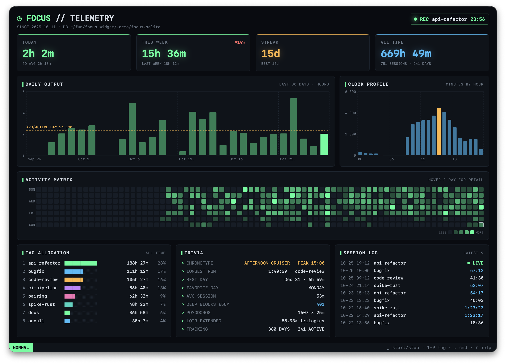

# Focus

A tiny macOS menu bar timer for focused work sessions. Pick a tag, hit a shortcut, and every
session lands in a single SQLite file you can query from anywhere.

```
◷ 25:13 coding        ← menu bar while a session runs
```



<sub>The stats window (⌃⌥S) with a year of seeded demo sessions.</sub>

- **Start / stop** from the menu or with a global shortcut (default **⌃⌥F**, Control-Option-F).
  The shortcut works in any app and needs no Accessibility permission.
- **Tags**: the next session reuses the last tag; the Tag submenu lists recent tags, and
  "New Tag…" lets you type one. Changing the tag while a session is running retags that session.
- **Today** totals per tag in the menu.
- **Stats** window (global **⌃⌥S**, or menu › Stats…): today / week / streak / all-time tiles,
  30-day bar chart, a year-long activity heatmap, hour-of-day profile, tag allocation, trivia
  (chronotype, longest run, best day, deep-work blocks ≥ 50 min…) and a recent-session log.
  Everything fits in the window without scrolling (charts and heatmap grow with it; minimum
  1100×840). Chrome-less (no title or buttons; drag it by the background) and driven by vim-style keys:

  | Normal mode | | Command line (`:`) | |
  |---|---|---|---|
  | `space` / `s` | start / stop | `:start [tag]`, `:s` | start, or switch tag |
  | `x` | stop | `:stop` | stop |
  | `1`–`9` | start the numbered tag | `:tag <tag>`, `:t` | set tag, retags a running session |
  | `i` / `t` | open `:start ` / `:tag ` | `:e`, `:reload` | reload |
  | `r` reload, `?` help | | `:q` | close |
  | `q` close, `esc` dismiss | | `tab`, `⌃u` `⌃w`, `esc` | complete tag, clear line / word, leave |
- **Persistence**: one SQLite file. A session left running when the app quits (or the Mac reboots)
  resumes on the next launch. Sessions under 5 seconds are discarded as accidental double-presses.
- **Options**: change the shortcut by recording a new key combo, stop automatically when the Mac
  sleeps (on by default), launch at login, reveal the database in Finder.

No dependencies: AppKit, Carbon (for the hotkey) and the system `sqlite3` library.
Builds with Xcode Command Line Tools alone.

## Build and run

```sh
make run        # swift run — runs straight from the package, no Dock icon
make app        # builds build/FocusWidget.app (release, ad-hoc signed)
make install    # copies it to /Applications
make test       # storage + formatting checks (swift run FocusCheck)
```

"Launch at Login" only works from the built `.app` bundle, not from `make run`.

## Data

Default location:

```
~/Library/Application Support/FocusWidget/focus.sqlite
```

Override with the `FOCUS_WIDGET_DB` environment variable (used for the smoke test, or to keep the
file in a synced folder).

Schema:

```sql
CREATE TABLE sessions (
    id         INTEGER PRIMARY KEY AUTOINCREMENT,
    tag        TEXT    NOT NULL,
    started_at INTEGER NOT NULL,   -- unix epoch seconds
    ended_at   INTEGER             -- NULL while running
);
```

Handy queries:

```sh
DB=~/Library/Application\ Support/FocusWidget/focus.sqlite

# Today's time per tag
sqlite3 "$DB" "SELECT tag, printf('%.1fh', SUM(COALESCE(ended_at, unixepoch()) - started_at) / 3600.0)
               FROM sessions WHERE started_at >= unixepoch('now', 'start of day', 'localtime', 'utc')
               GROUP BY tag ORDER BY 2 DESC;"

# Last 10 sessions
sqlite3 -header -column "$DB" "SELECT id, tag, datetime(started_at, 'unixepoch', 'localtime') AS started,
               (COALESCE(ended_at, unixepoch()) - started_at) / 60 AS minutes
               FROM sessions ORDER BY started_at DESC LIMIT 10;"

# Daily totals for the last 2 weeks
sqlite3 -header -column "$DB" "SELECT date(started_at, 'unixepoch', 'localtime') AS day,
               SUM(COALESCE(ended_at, unixepoch()) - started_at) / 60 AS minutes
               FROM sessions WHERE started_at >= unixepoch('now', '-14 days')
               GROUP BY day ORDER BY day DESC;"
```

## Layout

```
Sources/FocusCore/     SessionStore (SQLite), Stats, Format – UI-free, covered by FocusCheck
Sources/FocusWidget/   AppDelegate (status item + menu), HotKey (Carbon), Prompts (dialogs),
                       StatsWindow (SwiftUI + Swift Charts)
Sources/FocusCheck/    self-checking smoke test executable
Resources/Info.plist   LSUIElement = true (menu bar only)
Scripts/bundle.sh      builds build/FocusWidget.app
```

Preferences (last tag, shortcut, stop-on-sleep) live in `UserDefaults`. Note that `make run` and
the `.app` bundle use different defaults domains, so they keep separate preferences; the database
is shared.
